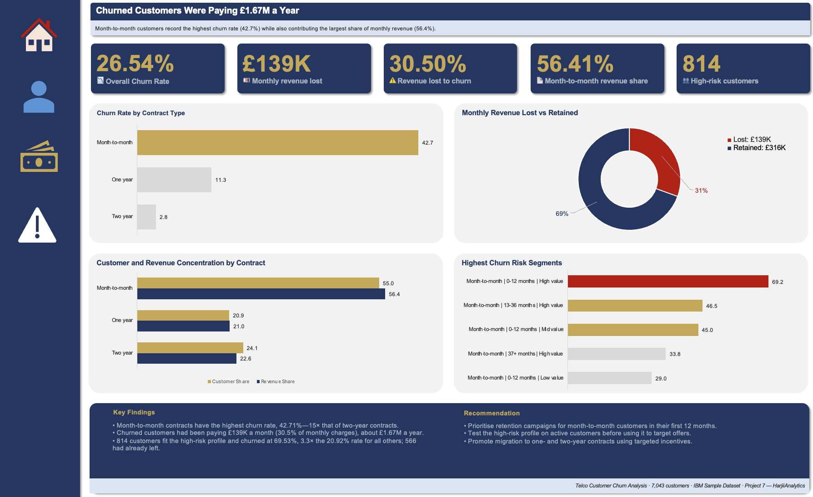
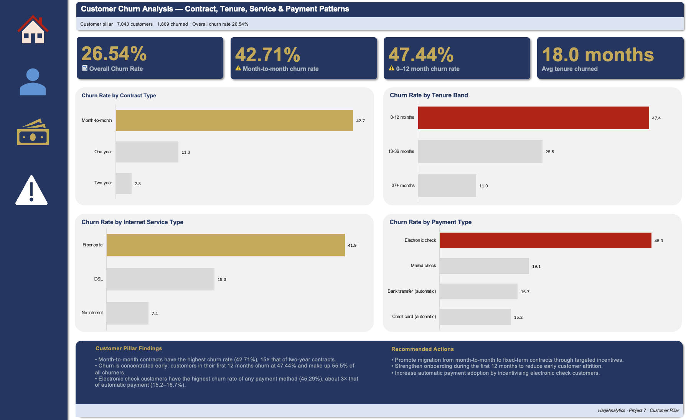
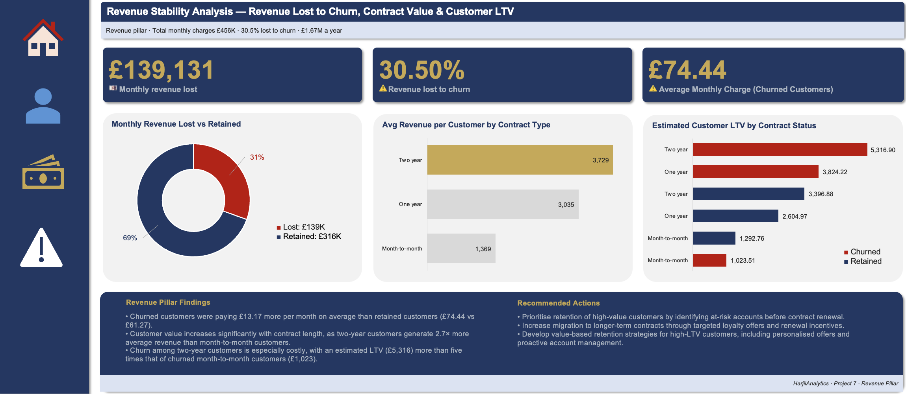
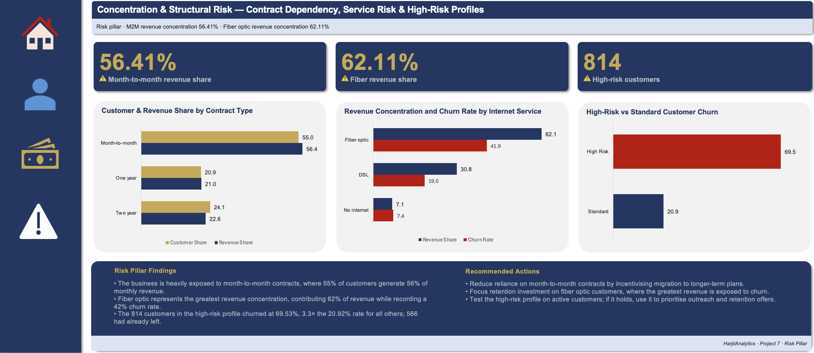

# Telco Customer Churn Analysis

Customer churn analysis of 7,043 telecom customers in MySQL and Microsoft Excel, organised around three questions: who churned, how much revenue they accounted for, and where the business is structurally exposed. Completed in July 2026 and brought in line with the Data Analysis Playbook v3.4 in October 2026.

> **Status:** Complete. 26.54% of customers churned, and they had been paying about £1.67M a year. Churn is concentrated in month-to-month contracts, the first 12 months of tenure, fibre-optic service and electronic-check payment.

---

# Results

| Measure | Result |
|---------|--------|
| Churn rate | **26.54%** (1,869 of 7,043 customers) |
| Monthly charges paid by churned customers | **£139,130.85**, 30.50% of all monthly charges |
| The same, annualised | **£1,669,570.20** |
| Month-to-month churn rate | **42.71%** (one-year 11.27%, two-year 2.83%) |
| First 12 months of tenure | **47.44%** churn rate; these customers are 55.5% of all churners |
| Fibre-optic service | **62.11%** of monthly revenue, with the highest churn rate of any service (41.89%) |
| Electronic-check payment | **45.29%** churn rate, about 3× the automatic payment rates (15.24–16.71%) |
| Month-to-month customers' share of monthly revenue | **56.41%** (55.02% of customers) |
| Profile: month-to-month, over £70 a month, under 12 months' tenure | **814** customers, 69.53% churned: 3.3× the 20.92% rate for all other customers |

- These are differences between groups in a single snapshot of customers. They show where churn happened, not why it happened, and they were not tested for statistical significance.
- 566 of the 814 customers in the profile had already churned, and the profile has not been tested on customers who are still active. It describes past churn; it does not predict who will leave next.
- The source data does not state a currency. Amounts are reported in pounds (£) for this project.

**Project page:** [taofeeksalami.com/Telco_Customer_Churn_Analysis](https://taofeeksalami.com/Telco_Customer_Churn_Analysis) · **Full summary:** [docs/executive_summary.md](docs/executive_summary.md)



<details>
<summary>Customer, revenue and risk dashboards</summary>







</details>

---

# Business Problem

A subscription telecom business loses customers every month. To decide where retention effort should go, it needs to know which customers left, how much recurring revenue they accounted for, and how much of the remaining revenue sits in the groups with the most churn.

# Business Question

Which customer groups have the highest churn, how much monthly revenue did churned customers account for, and how concentrated is revenue in those groups?

---

# Approach

- **Three pillars:** Customer (who churned), Revenue (what they were paying) and Risk (how concentrated revenue is)
- **Computation in SQL:** every metric is calculated by 22 MySQL queries, exported as 17 CSV files to `data/`
- **Reporting in Excel:** the CSV files are loaded into the workbook with Power Query, summarised in a 10-KPI framework and presented on four dashboards
- **Methods:** churn rates, shares and concentration by segment. No statistical testing or predictive modelling was used
- **Stack:** MySQL Workbench, Microsoft Excel (Power Query, structured tables, charts)

Scope, metric definitions, risks and limitations: [PROJECT_INFO.md](PROJECT_INFO.md). The charter was written retrospectively in October 2026 from the project's records, so it documents the decisions as they were made rather than setting them in advance.

This is a portfolio project on public sample data. The stakeholders are modelled on a typical subscription telecom business, and the findings are not evidence about any real company.

---

# Dataset

| Item | Details |
|------|---------|
| Source | Kaggle: [`blastchar/telco-customer-churn`](https://www.kaggle.com/datasets/blastchar/telco-customer-churn), originally IBM sample data |
| File | `WA_Fn-UseC_-Telco-Customer-Churn.csv` |
| Contents | One row per customer: demographics, contract, services, payment method, tenure, monthly and total charges, churn status. No dates |
| Size | 7,043 customers, 21 columns |
| Cleaning | 11 blank `TotalCharges` values (early-tenure customers) set to NULL; no rows removed ([phase_00_setup.md](docs/phase_00_setup.md)) |
| Checksum | Not recorded at download; the project predates the playbook's provenance standard |
| Licence | Set by the Kaggle listing. The raw file is not stored in this repository; `data/` holds only the aggregated SQL outputs |

---

# Project Phases

The project was run in eleven phases before the playbook settled on six. Each phase document records what was done at the time.

| Phase | Document | Playbook phase |
|-------|----------|----------------|
| 0 Environment setup and cleaning | [phase_00_setup.md](docs/phase_00_setup.md) | 0 Scoping & setup; 1 Data preparation |
| 1 SQL extraction and analysis | [phase_01_sql.md](docs/phase_01_sql.md) | 1 Exploration; 2 Business analysis |
| 2 Excel import and validation | [phase_02_excel_data_model.md](docs/phase_02_excel_data_model.md) | 2 Business analysis |
| 3 KPI framework | [phase_03_kpi_framework.md](docs/phase_03_kpi_framework.md) | 2 Business analysis |
| 4 Churn analysis | [phase_04_churn_analysis.md](docs/phase_04_churn_analysis.md) | 2 Business analysis |
| 5 Revenue stability | [phase_05_revenue_stability.md](docs/phase_05_revenue_stability.md) | 2 Business analysis |
| 6 Segment and concentration risk | [phase_06_segment_risk.md](docs/phase_06_segment_risk.md) | 2 Business analysis |
| 7 Dashboard design | [phase_07_dashboard_design_and_documentation.md](docs/phase_07_dashboard_design_and_documentation.md) | 5 Reporting |
| 8 Insights and recommendations | [phase_08_business_insights_and_recommendations.md](docs/phase_08_business_insights_and_recommendations.md) | 5 Reporting |
| 9 README and documentation | [phase_09_readme_and_documentation.md](docs/phase_09_readme_and_documentation.md) | 5 Reporting |
| 10 Polish and export | [phase_10_project_polish_and_export.md](docs/phase_10_project_polish_and_export.md) | 5 Reporting |

Playbook phases 3 (method selection) and 4 (advanced analytics) were not needed: every question was answered with descriptive SQL.

---

# Reproducibility

Requirements: MySQL with MySQL Workbench, and Microsoft Excel with Power Query.

1. Clone the repository:
   ```bash
   git clone https://github.com/HarjiiBoss/Telco_Customer_Churn_Analysis.git
   ```
2. Download `WA_Fn-UseC_-Telco-Customer-Churn.csv` from the Kaggle page above.
3. In MySQL Workbench, create the schema `telco_churn` and import the CSV into a table named `customers` with the Table Data Import Wizard. Import `TotalCharges` as text so the 11 blank values are kept for cleaning. Check that the table has 7,043 rows.
4. Run the scripts in `sql/` in order: `00_setup.sql` (cleaning), then `01a_exploration.sql` to `01e_advanced.sql`. Each query has a numbered heading comment.
5. Export each analysis query's result as a CSV file into `data/`, using the file names already there. Compare them with the committed files: the values should match.
6. Open `Telco_Churn_Analysis.xlsx`. To rebuild from your own exports, point each query at your `data/` folder (Data → Get Data → Data Source Settings → Change Source), then choose Data → Refresh All.
7. Run the figure check from the [Data Analysis Playbook](https://github.com/HarjiiBoss/analytics-playbook):
   ```bash
   python3 tools/check_figures.py path/to/Telco_Customer_Churn_Analysis
   ```
   Derived figures checked by hand are listed with their calculations in `.figures-allow`.

---

# Repository Structure

```text
Telco_Customer_Churn_Analysis/
├── dashboard/                  # Dashboard images exported from the workbook
├── data/                       # The 17 SQL outputs (CSV) loaded by the workbook
├── docs/
│   ├── index.html              # Project page (taofeeksalami.com/Telco_Customer_Churn_Analysis)
│   ├── executive_summary.md    # Findings and recommendations for decision-makers
│   ├── data_dictionary.md      # Every table and column in the workbook
│   ├── documentation_index.md  # Index of all project documents
│   └── phase_00 … phase_10     # Phase records
├── sql/                        # MySQL scripts, run in numbered order
├── .figures-allow              # Derived figures checked by hand, with their calculations
├── PROJECT_INFO.md             # Project charter (written retrospectively)
├── README.md
├── Telco_Churn_Analysis.xlsx   # Power Query data layer, KPI framework and dashboards
└── LICENSE
```

---

# Documentation

| Document | Purpose |
|----------|---------|
| [PROJECT_INFO.md](PROJECT_INFO.md) | Project charter: question, metrics, scope, risks and limitations |
| [docs/executive_summary.md](docs/executive_summary.md) | Findings, recommendations and limitations for decision-makers |
| [docs/data_dictionary.md](docs/data_dictionary.md) | Definition of every table and column in the workbook |
| [docs/documentation_index.md](docs/documentation_index.md) | Index of all project documents |
| [docs/phase_00_setup.md](docs/phase_00_setup.md) to [docs/phase_10_project_polish_and_export.md](docs/phase_10_project_polish_and_export.md) | Phase records (see Project Phases) |

---

# License

The code and documentation in this repository are released under the MIT License. The dataset is not covered by this licence; its terms are set by its Kaggle listing.

---

## Corrections

**29 October 2026**

- **Customer and revenue share by contract (charts):** the `Segment_Risk` sheet read the One year and Two year rows from each other's source rows, so three charts showed the two contracts' shares swapped. One year is 20.91% of customers and 21.01% of monthly revenue; Two year is 24.07% and 22.58%. The formulas now point at their own rows and the dashboard images have been re-exported. No figure in this README or on the project page used the swapped values.
- **Revenue dashboard:** the second KPI card was linked to the monthly £ figure (`KPI_Framework!C9`) instead of the percentage (`C10`). Older images showed 30.50% only because Excel had not refreshed the card; it now reads from `C10`.
- **Customer dashboard:** "47.44% of churn occurring within the first 12 months" corrected. 47.44% is the churn rate of customers in their first 12 months; they make up 55.5% of all churners.
- **Payment method:** electronic check churn (45.29%) is about 3× the automatic payment rates (15.24–16.71%), not "more than 3×".
- **Dashboard wording:** "revenue at risk" relabelled "revenue lost to churn"; "churn driver" replaced with "highest churn rate"; the high-risk profile is described as where churn happened (566 of the 814 had already churned), not as a list of customers to target.
- **README and documents:** "nearly one in four customers has churned" corrected (26.54% is more than one in four); causal and predictive wording ("drivers of churn", "strongest predictor", "identifiable before churn") replaced with what the data shows; a recommendation based on "customers with increasing monthly charges" removed, because the data is a single snapshot with no change over time.

**26 October 2026**

- Churn share, revenue-lost wording and the high-risk claims corrected after the portfolio audit (pull request #1).

## Published Surfaces

Every place this project's findings appear outside this repository. When a figure changes, each one is updated and its date refreshed (Data Analysis Playbook v3.4, Published Surfaces).

| Surface | Link | Figures quoted | Last checked |
|---------|------|----------------|--------------|
| Project page | [taofeeksalami.com/Telco_Customer_Churn_Analysis](https://taofeeksalami.com/Telco_Customer_Churn_Analysis) | Full findings | 29 Oct 2026 |
| Portfolio site card | [taofeeksalami.com](https://taofeeksalami.com) | 26.54% churn, £1.67M lost, 55.5% in first year, 30.50% of monthly charges, 814 customers at 69.53% | 29 Oct 2026 |
| GitHub profile README | [github.com/HarjiiBoss](https://github.com/HarjiiBoss) | 26.54%, £1.67M, 55.5%, 42.71%, 62.11%, 41.89%, 30.50% | 29 Oct 2026 |
| Resume | — | 26.54%, £1.67M, 30.50%, 62.11%, 41.89% | 29 Oct 2026 |
| LinkedIn About | [LinkedIn profile](https://linkedin.com/in/taofeek-salami-460a93245) | 26.54% churn, 55.5% in first year | 29 Oct 2026 |
| LinkedIn post | [Project post](https://lnkd.in/p/eY2ciKwr) | 26.54%, 42.71%, 62.11%, 41.89%, 814 customers at 69.53% (3× the rest), 566 already churned | 29 Oct 2026, after the edit |
